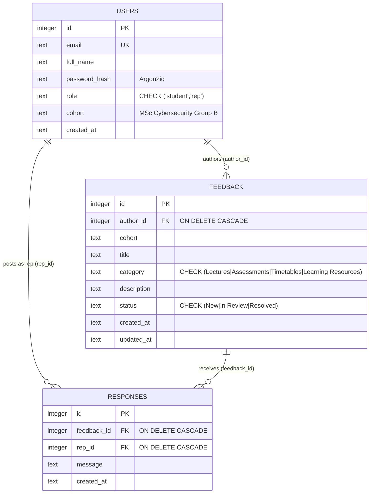
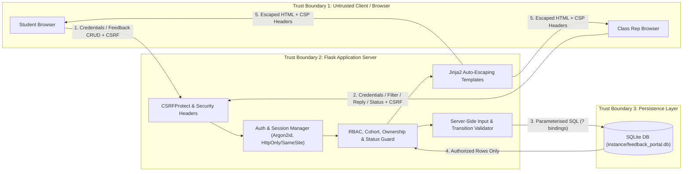

# Database Design, Data Flows, Trust Boundaries & Misuse Cases

## 1. Relational Data Model (MSc Cybersecurity Group B)

The database layer is defined in [migrations/001_initial_schema.sql](../migrations/001_initial_schema.sql) and mapped in [app/models.py](../app/models.py).

### Key Integrity & Deletion Rules
- **Foreign Keys Enforced:** `PRAGMA foreign_keys = ON;` runs on every SQLite connection in `connect_sqlite()`.
- **Cascade Deletion:** Deleting a `New` `feedback` item cleanly removes any dependent `responses` via `ON DELETE CASCADE`.
- **Database Check Constraints:** `role`, `category`, and `status` are constrained at the schema level as a second line of defense behind server-side allow-list validation.

---

## 2. Data Flow Diagram & Trust Boundaries

### Trust Boundary Controls
1. **TB1 → TB2 (Browser to Flask Server):** Every request crosses from untrusted user input into the server. All `POST` routes require a valid CSRF token (`CSRFProtect`), cookie sessions are signed and marked `HttpOnly` + `SameSite=Lax`, and all form values are validated on the server regardless of client HTML attributes.
2. **TB2 Internal (Authentication → Authorization):** Authentication alone never grants data access. Every read, edit, delete, reply, and status change calls `@login_required` / `@role_required` and `get_authorized_feedback()` to verify **cohort**, **role**, **author ownership**, and **`New` status lock** before returning data or mutating state.
3. **TB2 → TB3 (Application to SQLite):** Every query is a static SQL statement with `?` parameter bindings (`PRAGMA foreign_keys = ON`), preventing SQL injection across authentication, CRUD, and rep queue filtering.

---

## 3. Misuse & Abuse Cases

| ID | Threat Actor | Misuse Scenario | Security Impact | Implemented Mitigation & Verification |
| :--- | :--- | :--- | :--- | :--- |
| **MC1** | Authenticated Student B | **Horizontal IDOR:** Student B changes the URL ID (`/feedback/1`, `/feedback/1/edit`, `/feedback/1/delete`) to read, modify, or delete Student A's private feedback. | Confidentiality & integrity breach of classmate feedback. | `get_authorized_feedback()` verifies `feedback.author_id == user.id` for students and aborts with **HTTP 403**. Verified in `tests/test_access_control.py`. |
| **MC2** | Authenticated Student | **Vertical Privilege Escalation:** Student navigates directly to `/rep/dashboard` or sends forged `POST` requests to `/rep/feedback/<id>/respond` or `/status`. | Unauthorized status manipulation or viewing all cohort submissions. | `@role_required("rep")` blocks non-rep sessions with **HTTP 403**. Verified in `tests/test_access_control.py`. |
| **MC3** | Authenticated Student (Author) | **Post-Review Tampering:** Student attempts to edit or delete their own submission after a rep moves it to `In Review` or `Resolved`, or submits `status=Resolved` on creation. | Loss of audit integrity after rep review begins. | Create route hardcodes `status='New'`; `require_owner_new=True` blocks edit/delete with **HTTP 403** whenever `status != 'New'`. Verified in `tests/test_student_crud.py`. |
| **MC4** | Out-of-Cohort Rep | **Cross-Cohort Access:** A class rep from Cohort A attempts to query or respond to Cohort B feedback. | Leakage of Group B submissions across cohorts. | Queue filter and `get_authorized_feedback()` enforce `feedback.cohort == user.cohort` (**HTTP 403**). Verified in `tests/test_access_control.py`. |
| **MC5** | Unauthenticated / External Attacker | **SQL Injection, Stored XSS, or CSRF:** Attacker submits `' OR '1'='1`, ``, or tricks a signed-in user into submitting a cross-origin `POST`. | Auth bypass, session theft, or unauthorized state change. | `?` parameterised queries, Jinja2 auto-escaping + strict `Content-Security-Policy`, and `CSRFProtect` (`HTTP 400`). Verified in `tests/test_auth_and_csrf.py` and `tests/test_rep_workflow.py`. |

---

## 4. Security Requirements Traceability (SR1–SR5)

| Req ID | Security Requirement | Implementation Location |
| :--- | :--- | :--- |
| **SR1** | Authentication & Argon2id password hashing + generic login error | `app/security.py`, `app/routes/auth.py` |
| **SR2** | Session cookie hardening (`HttpOnly`, `SameSite=Lax`) & CSRF protection | `app/config.py`, `app/__init__.py`, all POST templates |
| **SR3** | Server-side role, cohort, ownership & `New`-status authorization | `app/security.py`, `app/routes/student.py`, `app/routes/rep.py` |
| **SR4** | Server-side allow-list validation, length bounds, safe HTML escaping & CSP | `app/security.py`, `app/__init__.py`, `app/templates/*` |
| **SR5** | Parameterised SQLite access, foreign keys & schema `CHECK` constraints | `migrations/001_initial_schema.sql`, `app/db.py`, `app/routes/*` |
